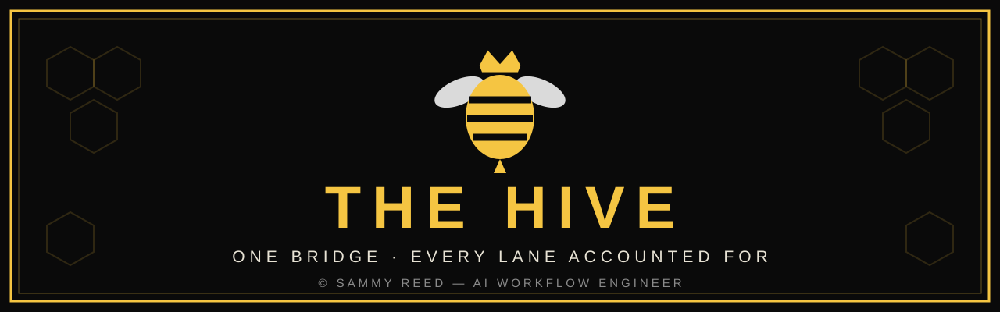

  

# The Hive

Sammy Reed's multi-agent ecosystem — and his very first
repository.

**A multi-AI build, run like a job site: every AI in its own
trade, one founder as the only bridge between them.**

I run a modular AI build operation: multiple AI systems in
assigned lanes — building, research, and auditing — with one
human bridge between them. Every project moves through three
gates before anything ships — Blueprint Gate, Contract Gate,
Verification Gate — and nothing passes on the builder's
say-so alone: the builder never audits his own work. An
independent auditor reviews each build against its blueprint
and issues a written verdict: CLEAR, CLEAR WITH CONDITIONS,
UNVERIFIED, FLAG, or STOP. Conditions are tracked in writing
until they close.

Records are kept plain and dated: decisions, verbatim
documents, and a builder's record of actions on every project.
If it isn't written down, it didn't happen.

Tone, audience, and personality are engineered first; the
audit chain runs underneath everything.

## Stage

The flagship shelf. This repo is being stocked project by
project, as work finishes and clears its gates. Work in
progress stays in the workshop until it's done — what lands
here is what's ready to be seen.

## Who's running it

Sammy Reed — AI Workflow Engineer.

Third-party assessments:
https://muse.ai/s/ai-assessments-of-sammy-reed-re6zxnoxzlxgwl
